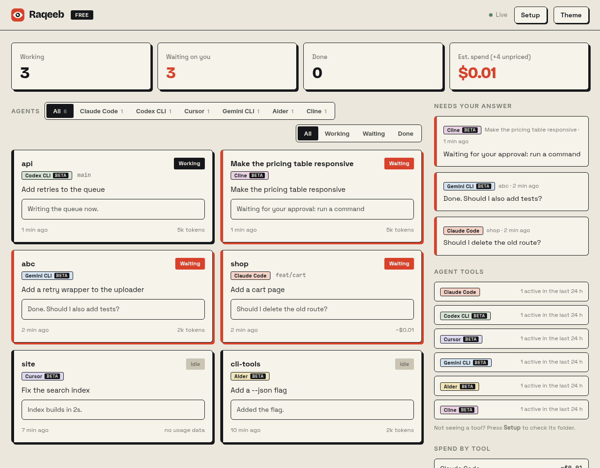
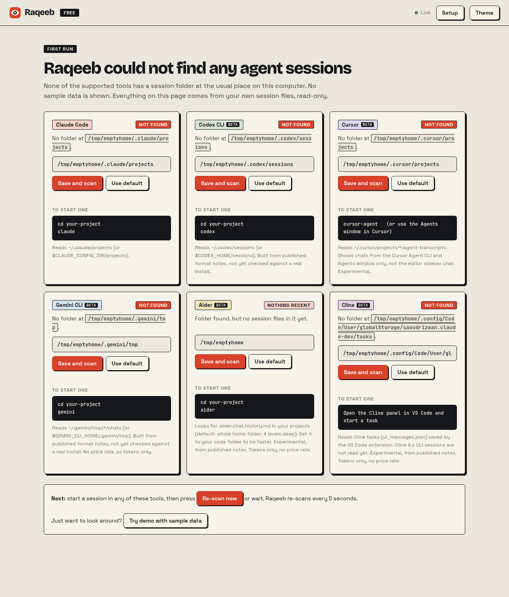

# Raqeeb (رقيب)

**One local control room for all your AI coding agents: Claude Code, Codex CLI, Cursor, Gemini CLI, Aider and Cline.**

Raqeeb means "watcher" in Arabic. If you run more than one agent at once, often more than one kind, you lose track of them: which one is still working, which one stopped to ask you something, and what the day is costing. Raqeeb puts all of that on one page, on your own machine.




## What you get

- **One board for every agent, from every tool.** Six tools side by side. Each card has a tool badge, project, branch, task, last message and a status: working, idle, waiting on you, or done. Filter by tool.
- **An inbox of open questions.** When an agent ends its turn with a question, it shows up in "Needs your answer" so you can find it fast.
- **Spend per tool and per project.** An estimate where a price is known (Claude Code), and token counts only where it is not. Raqeeb never invents a price.
- **Light and dark mode**, and a layout that works on a phone-sized window.
- **Local only.** Reads files already on your disk. No account, no telemetry, nothing uploaded. The server listens on `127.0.0.1`, so other machines cannot reach it.
- **Zero dependencies.** One small Node program. Nothing to install besides Node.

| Dark mode | Narrow window |
| --- | --- |
|  |  |

## Quick start

You need [Node.js](https://nodejs.org) 18 or newer.

**Option 1: run it straight from GitHub (no download step)**

```
npx github:mafk21/raqeeb
```

**Option 2: clone it**

```
git clone https://github.com/mafk21/raqeeb.git
cd raqeeb
node server.js
```

**Option 3: download a ZIP**

On the [repo page](https://github.com/mafk21/raqeeb), click **Code**, then **Download ZIP**. Unzip it, open a terminal in the folder, and run `node server.js`.

Then open **http://localhost:4317** in your browser. The page refreshes every 5 seconds.

### First run

The first time you open Raqeeb it checks the usual folder of each supported tool and tells you plainly what it found, tool by tool. If it cannot find any sessions it says so and shows a setup screen with one panel per tool. It never fills the page with made-up data.



1. **Check each tool's panel.** It says Detected, Nothing recent or Not found, shows where Raqeeb looked, and lists other folders it finds. Type a different path and press **Save and scan** if yours lives elsewhere. Raqeeb remembers it in `~/.raqeeb/config.json`. You only need one tool to have sessions.
2. **Start a session** in any of them (the panel shows the command).
3. **Re-scan.** Press the button, or wait, the page checks every 5 seconds.

If a tool has no recent sessions it keeps its own empty state, and the dashboard shows a per-tool status strip so you can see which tools Raqeeb is reading.

Just want to look around? Press **Try demo with sample data** on that screen, or run `node server.js --demo`. Demo data is always marked with a red "DEMO" banner. You can reopen the setup screen any time with the **Setup** button in the top bar.

## Using it

1. Start Raqeeb and leave it open in a browser tab.
2. Use your agents as you normally do, in as many terminals and tools as you like. Sessions show up on their own.
3. Watch the **Needs your answer** list. Click an agent card to see its task, last message, token usage and working folder.
4. Use the tool chips (All, Claude Code, Codex CLI, Cursor) and the status filter (All, Working, Waiting, Done) to focus.

If Raqeeb finds no session from the last 24 hours in any tool it shows the setup screen, not sample data.

### Options

```
raqeeb [options]

  --demo           start in demo mode with sample data
  --port, -p N     port to listen on (default 4317, or $PORT)
  --claude-dir PATH  Claude Code projects folder (--dir is the same)
  --codex-dir PATH   Codex CLI sessions folder
  --cursor-dir PATH  Cursor projects folder
  --gemini-dir PATH  Gemini CLI folder (~/.gemini/tmp)
  --aider-dir PATH   folder to search for .aider.chat.history.md
  --cline-dir PATH   Cline tasks folder
  --version, -v    print the version
  --help, -h       show help
```

For each tool the folder is chosen in this order: its command-line option, the folder you saved on the setup screen, then the default in the table below.

## Supported agents

| Tool | Status | Default folder | What Raqeeb reads | Based on |
| --- | --- | --- | --- | --- |
| Claude Code | supported | `~/.claude/projects` (or `$CLAUDE_CONFIG_DIR/projects`) | session `.jsonl`: task, branch, model, token usage | [Claude Code docs for the location; format notes at harnessnotes.com](https://harnessnotes.com/session-transcripts/format) |
| Codex CLI | **experimental** | `~/.codex/sessions` (or `$CODEX_HOME/sessions`) | `rollout-*.jsonl`: session_meta, turn_context, event_msg (user and agent messages, token_count) | [agenthud schema notes](https://github.com/neochoon/agenthud/blob/main/docs/schemas/codex-session.md), [harnessnotes](https://harnessnotes.com/session-transcripts/format), [bough.run](https://www.bough.run/articles/what-is-in-a-codex-rollout-file) |
| Cursor | **experimental** | `~/.cursor/projects` | `*/agent-transcripts/<id>/<id>.jsonl` (Cursor Agent CLI and Agents window) | [harnessnotes](https://harnessnotes.com/session-transcripts/format), [agent-sessions guide](https://jazzyalex.github.io/agent-sessions/guides/cursor-agent-local-history.html), [vibecorral](https://vibecorral.com/cursor-cli) |
| Gemini CLI | **experimental** | `~/.gemini/tmp` (or `$GEMINI_CLI_HOME/.gemini/tmp`) | `<project>/chats/session-*.json` and `.jsonl`: user and `gemini` messages, model, token counts | [Gemini CLI chatRecordingTypes.ts](https://github.com/google-gemini/gemini-cli/blob/f8541cf7/packages/core/src/services/chatRecordingTypes.ts), [session docs](https://geminicli.com/docs/cli/session-management/), [deja format notes](https://vshulcz.github.io/deja-vu/registry/gemini.html) |
| Aider | **experimental** | your home folder, searched 4 levels deep (set it to your code folder) | `.aider.chat.history.md` in each repo: the latest run's `#### ` prompts, replies and the `> Tokens:` line | [groundedby.com Aider notes](https://groundedby.com/agents/aider), [Aider options](https://aider.chat/docs/config/options.html), [Aider args.py](https://github.com/Aider-AI/aider/blob/main/aider/args.py) |
| Cline | **experimental** | `~/.config/Code/User/globalStorage/saoudrizwan.claude-dev/tasks` (macOS and Windows paths in the code) | `<task>/ui_messages.json`: task, replies, follow-up questions, approvals, `api_req_started` token counts | [Cline ExtensionMessage.ts](https://github.com/cline/cline/blob/8a6441fd/src/shared/ExtensionMessage.ts), [session format notes](https://github.com/rajbos/ai-engineering-fluency/blob/main/docs/logFilesSchema/cline-session-format.md), [llm-usage-metrics](https://ayagmar.github.io/llm-usage-metrics/sources/cline/) |


**What "experimental" means here.** None of these tools promises a stable log format for outsiders (Gemini CLI and Cline are open source, so their record types are readable, but they can change). The Codex, Cursor, Gemini, Aider and Cline readers were written from the community format notes linked above and tested only with sample files built from those notes. The author has not run them against a real Codex or Cursor install. They may miss fields or break after a tool update. They are marked **beta** in the dashboard for that reason. If one misreads your logs, please open an issue (without pasting private code).

Cursor specifics: Raqeeb reads the plain-text transcript copy that the Cursor Agent keeps. That copy has no token counts, so Cursor cards show "no usage data". The editor's own sidebar chats live in a SQLite database (`state.vscdb`) and are **not** read. Gemini specifics: tokens are summed from each reply's `tokens` field (output includes reasoning tokens). Aider specifics: history lives inside each repo, so Raqeeb searches a folder tree (cached for a minute, `node_modules` and hidden tool folders skipped). Tokens come from Aider's quoted `> Tokens:` line, which I am least sure of, and a custom `--chat-history-file` name is not found. Cline specifics: reads the VS Code extension's task files only. Cline 4.x CLI sessions (`~/.cline/data/sessions`) are not read yet. Cline's own cost field is not used. Codex specifics: token counts come from the `token_count` events; Codex has no price table in Raqeeb, so it shows tokens only.

Want another tool? See [CONTRIBUTING.md](CONTRIBUTING.md#adding-an-agent-provider). It is one small file.

## How it decides what an agent is doing

Raqeeb reads the session logs (`.jsonl` files) each tool writes, read-only, and never changes them. The same rules apply to every tool.

| Status | Rule |
| --- | --- |
| Working | the session file changed in the last 2 minutes |
| Idle | changed 2 to 30 minutes ago |
| Waiting on you | the last assistant message ends with a question mark, and is under 2 hours old |
| Done | nothing for 30 minutes and no open question |

Sessions untouched for 24 hours are hidden.

## Honest limitations

- **Three tools for now.** Claude Code, Codex CLI, Cursor, Gemini CLI, Aider and Cline. Copilot agent mode, Windsurf, OpenCode, Amp and others are not read yet. Everything except Claude Code is experimental (see above).
- **Status is a guess.** It comes from file timestamps and whether the last message was a question. An agent that asks something without a question mark will look "idle" or "done". A long tool run with no output can look idle.
- **Cost is an estimate, and only where a rate is set.** Claude Code uses example per-token rates in [`lib/pricing.js`](lib/pricing.js), with cache reads not counted. The other five have no rates, so they show tokens (or "no usage data") and are left out of the dollar total, which says how many are unpriced. Rates change and plans differ, so treat the number as a rough guide, not a bill. Add rates in that file if you want them.
- **It only watches.** You cannot answer or approve from the dashboard yet. Go back to the terminal to reply.
- **Tested with sample files, not real installs.** The automated tests use fixture files written from each tool's published format notes. Nothing has been checked against real Claude Code, Codex or Cursor logs yet. If your real logs look different and something shows wrong, please open an issue.

## Roadmap: Raqeeb Pro (not built yet)

The free app stays free and open source. A paid layer is planned for people who run agents all day:

- Approve or redirect an agent from your phone
- Limits on which files and commands an agent may touch
- Alerts when a model's quality drops
- Team features (shared policies, audit log)

These do not exist yet and nothing in this repo is locked or phones home. If you want them, join the waitlist on the Raqeeb website and tell us what matters most.

## Development

```
npm test          # runs the automated tests (Node's built-in test runner)
npm run demo      # starts the app with sample data
```

Layout:

```
server.js         the HTTP server and command-line options
lib/sessions.js   combines all providers into one list
lib/providers/    one adapter per tool (claude, codex, cursor, gemini, aider, cline)
lib/common.js     shared scanning, status and parse cache
lib/pricing.js    example token rates (Claude only)
public/           the dashboard (plain HTML, CSS and JavaScript)
test/             automated tests
```

## Contributing

Issues and pull requests are welcome. See [CONTRIBUTING.md](CONTRIBUTING.md). Good first things: an adapter for another coding agent (it is one file), better status detection, and real-session bug reports.

## Privacy and security

Raqeeb never sends data anywhere. It reads local files and serves a page on `127.0.0.1`. It only answers requests addressed to localhost, and the setup endpoint accepts same-origin requests only, so a web page you visit cannot change the folder. The only file it writes is `~/.raqeeb/config.json` (the folder you chose). Session logs can contain your code and prompts, so do not expose the port to a network.

## License

[MIT](LICENSE)
