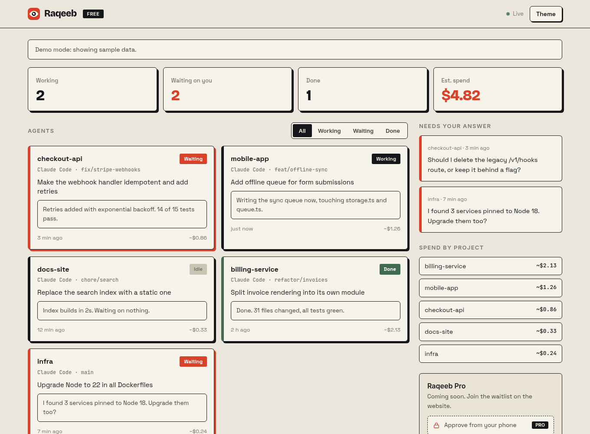
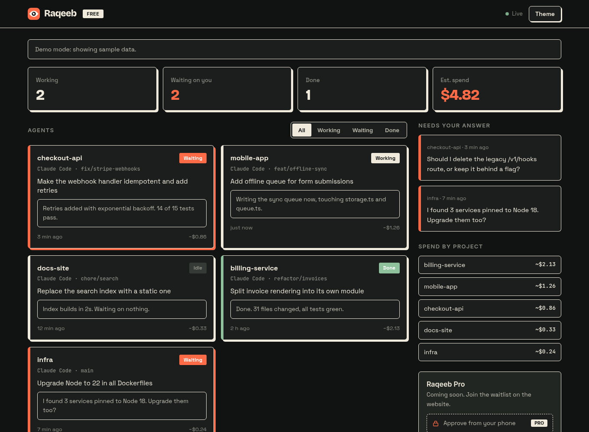

# Raqeeb (رقيب)

**A local control room for the AI coding agents you run.**

Raqeeb means "watcher" in Arabic. If you run several Claude Code sessions at once, you lose track of them: which one is still working, which one stopped to ask you something, and what the day is costing. Raqeeb puts all of that on one page, on your own machine.



## What you get

- **One board for every agent.** Project, branch, task, last message, and a status: working, idle, waiting on you, or done.
- **An inbox of open questions.** When an agent ends its turn with a question, it shows up in "Needs your answer" so you can find it fast.
- **Cost estimates.** Per agent and per project, from the token counts in the session logs.
- **Light and dark mode**, and a layout that works on a phone-sized window.
- **Local only.** Reads files already on your disk. No account, no telemetry, nothing uploaded. The server listens on `127.0.0.1`, so other machines cannot reach it.
- **Zero dependencies.** One small Node program. Nothing to install besides Node.

| Dark mode | Narrow window |
| --- | --- |
|  |  |

## Quick start

You need [Node.js](https://nodejs.org) 18 or newer.

**Option 1: run it straight from GitHub (no download step)**

```
npx github:mafk21/raqeeb
```

**Option 2: clone it**

```
git clone https://github.com/mafk21/raqeeb.git
cd raqeeb
node server.js
```

**Option 3: download a ZIP**

On the [repo page](https://github.com/mafk21/raqeeb), click **Code**, then **Download ZIP**. Unzip it, open a terminal in the folder, and run `node server.js`.

Then open **http://localhost:4317** in your browser. The page refreshes every 5 seconds.

Want to look around first? Run `node server.js --demo` to see sample data.

## Using it

1. Start Raqeeb and leave it open in a browser tab.
2. Use Claude Code as you normally do, in as many terminals as you like. Sessions show up on their own.
3. Watch the **Needs your answer** list. Click an agent card to see its task, last message, token usage and working folder.
4. Use the filter (All, Working, Waiting, Done) to focus.

If Raqeeb finds no session from the last 24 hours, it shows sample data and says so in a banner at the top.

### Options

```
raqeeb [options]

  --demo           show sample data instead of reading your sessions
  --port, -p N     port to listen on (default 4317, or $PORT)
  --dir PATH       Claude Code projects folder
  --version, -v    print the version
  --help, -h       show help
```

By default it reads `~/.claude/projects`. If you set `CLAUDE_CONFIG_DIR`, it reads `$CLAUDE_CONFIG_DIR/projects` instead. Use `--dir` for any other location.

## How it decides what an agent is doing

Raqeeb reads the session logs (`.jsonl` files) Claude Code writes, read-only, and never changes them.

| Status | Rule |
| --- | --- |
| Working | the session file changed in the last 2 minutes |
| Idle | changed 2 to 30 minutes ago |
| Waiting on you | the last assistant message ends with a question mark, and is under 2 hours old |
| Done | nothing for 30 minutes and no open question |

Sessions untouched for 24 hours are hidden.

## Honest limitations

- **Claude Code only** for now. Other agents (Codex, Cursor, Aider and so on) are not read yet.
- **Status is a guess.** It comes from file timestamps and whether the last message was a question. An agent that asks something without a question mark will look "idle" or "done". A long tool run with no output can look idle.
- **Cost is an estimate.** It uses the input, cache-write and output token counts with example per-token rates in [`lib/pricing.js`](lib/pricing.js). Cache reads are not counted. Rates change and plans differ, so treat the number as a rough guide, not a bill. Edit the file to match your rates.
- **It only watches.** You cannot answer or approve from the dashboard yet. Go back to the terminal to reply.
- **Tested with sample session files** that follow Claude Code's log format and with the automated tests below. If your real logs look different and something shows wrong, please open an issue.

## Roadmap: Raqeeb Pro (not built yet)

The free app stays free and open source. A paid layer is planned for people who run agents all day:

- Approve or redirect an agent from your phone
- Limits on which files and commands an agent may touch
- Alerts when a model's quality drops
- Team features (shared policies, audit log)

These do not exist yet and nothing in this repo is locked or phones home. If you want them, join the waitlist on the Raqeeb website and tell us what matters most.

## Development

```
npm test          # runs the automated tests (Node's built-in test runner)
npm run demo      # starts the app with sample data
```

Layout:

```
server.js         the HTTP server and command-line options
lib/sessions.js   reads and classifies Claude Code sessions
lib/pricing.js    example token rates
public/           the dashboard (plain HTML, CSS and JavaScript)
test/             automated tests
```

## Contributing

Issues and pull requests are welcome. See [CONTRIBUTING.md](CONTRIBUTING.md). Good first things: support for another coding agent's log format, better status detection, and real-session bug reports.

## Privacy and security

Raqeeb never sends data anywhere. It reads local files and serves a page on `127.0.0.1`. Session logs can contain your code and prompts, so do not expose the port to a network.

## License

[MIT](LICENSE)
